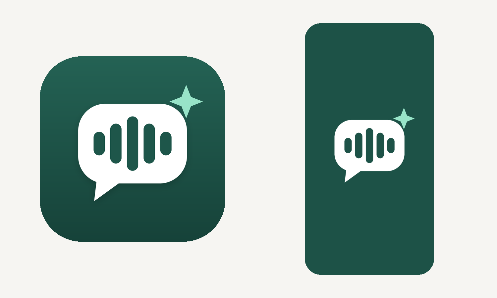

# 来电助手 · iOS App

SwiftUI 原型，iOS 17+，只支持 iPhone、竖屏。界面暂时只有中文。



## 功能

| 页面 | 作用 |
| --- | --- |
| 登录 | 手机号 + 短信验证码（Supabase Auth，短信由 Twilio Verify 发送），验证码填满自动登录。登录凭证存进钥匙串，访问令牌过期前自动刷新 |
| 首次引导 | 新用户登录后先填称呼、选男声或女声，完成后才进入主界面 |
| 来电 | AI 接听过的电话列表，可筛选「全部 / 需回电 / 骚扰诈骗」；下拉刷新；详情页有中文摘要、来意、诈骗风险、完整转写，可回电、复制号码、拉黑 |
| 代接设置 | 一键开启或关闭代接，分项设置与查询；iPhone 设置检查清单 |
| 我的 | 手机号、代接号码、AI 助手（称呼、男声 / 女声、音色：成熟 / 稳重 / 年轻）、来电助手 Pro（订阅状态）、隐私说明、退出登录、删除账户（删除前提醒取消苹果订阅、关闭呼叫转移） |
| 订阅 | StoreKit 2 自动续期订阅：方案、免费试用、恢复购买、管理订阅。产品 ID 在 `project.yml` 的 `IAP_PRODUCT_IDS`，App Store Connect 的设置见根目录 README「苹果内购」 |

**为什么要手动输入手机号**：iOS 不允许 App 读取本机号码（没有公开接口，用私有接口会被拒审）。号码框设置成 `.telephoneNumber`，键盘会建议「通讯录 › 我的名片」里的号码，点一下即可填入；验证码框是 `.oneTimeCode`，短信到达后键盘上方会出现验证码，点一下填入后自动登录。国内格式（`0412 345 678`）按澳洲号码补全成 `+61…`，其他国家的号码需要带 `+` 和国家码。

**为什么不能一键拨打转移代码**：iOS 规定，App 打开的电话号码里只要含 `*` 或 `#`，电话 App 就不会拨出。所以 App 的做法是自动复制代码，并提示你到「电话 › 拨号键盘」长按粘贴后拨出。

## 在 Mac 上构建

需要 Xcode 15 或更新版本。

```bash
brew install xcodegen
cd ios
xcodegen generate
open CallAssistant.xcodeproj
```

1. 后端地址写在 `project.yml` 的 `API_HOST`（默认 `aicallassistantclaude.vercel.app`），编译时写进 Info.plist，用户不用填。换了 Vercel 域名就改这里，再运行一次 `xcodegen generate`。
2. 签名已写在 `project.yml`：Bundle ID `com.homeau.callassistant`，团队 Everyone Delivery Pty Ltd（`DEVELOPMENT_TEAM` 填的是 Team ID），自动签名。生成工程后不用再到 Signing & Capabilities 里选 Team。
3. 连接 iPhone，选择设备，按 ⌘R 运行。
4. 运行单元测试：⌘U。

`CallAssistant.xcodeproj` 和 `Info.plist` 由 XcodeGen 生成，不提交到仓库。增删源码文件或修改 `project.yml` 后，重新运行一次 `xcodegen generate`。

## 后端要求

- `GET /api/auth-config`：Supabase 项目地址和 anon key，不需要登录
- 登录本身直接调用 Supabase Auth：`POST /auth/v1/otp` 发验证码，`POST /auth/v1/verify` 校验，`POST /auth/v1/token?grant_type=refresh_token` 刷新

下面几个接口需要 `Authorization: Bearer <Supabase 访问令牌>`，后端用它确认用户和手机号：

- `GET /api/app-config`：代接号码、登录手机号、AI 助手设置、订阅状态
- `PATCH /api/profile`：修改称呼、男声 / 女声、音色
- `GET /api/calls`：归属给当前用户的来电记录
- `POST /api/admin/blocklist`：拉黑号码（只影响打给自己的电话）

后端要先在 Vercel 加上 `SUPABASE_ANON_KEY`，在 Supabase 重新运行一次 `supabase/schema.sql`，并开启手机号登录（见根目录 README 的部署步骤 1）。

## 目录

```
ios/
├── project.yml                  XcodeGen 配置
├── CallAssistant/
│   ├── App/                     入口与标签页
│   ├── Features/
│   │   ├── Setup/               手机号登录
│   │   ├── Calls/               来电列表与详情
│   │   ├── Forwarding/          呼叫转移代码
│   │   └── Settings/            我的
│   ├── Models/                  来电数据、转移代码
│   ├── Services/                网络请求、Supabase 登录、会话、钥匙串
│   └── Resources/Assets.xcassets  图标、开屏 Logo、主题色
├── CallAssistantTests/          单元测试
└── docs/                        图标预览与生成脚本
```

## 设计

- 主色是深青绿（浅色模式 `#246E5E`，深色模式 `#7AC4AC`），定义在 `AccentColor`。
- 图标：深青绿底，白色对话气泡里是一段声波，代表"把来电变成文字"；右上角的薄荷绿星光代表 AI。
- 开屏：深青绿背景（`LaunchBackground`），中间是白色气泡 Logo。
- 修改图标：编辑 `docs/make_icons.py` 后运行 `python3 docs/make_icons.py CallAssistant/Resources`，再把生成的 `CallAssistant/icon-preview.png` 移到 `docs/`。

## 以后要做的

- **英文**：界面文字已用 SwiftUI 的本地化写法（`Text("…")`）。在 Xcode 里新建 String Catalog（Localizable.xcstrings），构建一次会自动收集所有中文文案，补上英文翻译即可。
- **号码池**：给运营商不带转移来源的用户分配独立的 Twilio 号码。
- **来电推送**：通话结束后通过 APNs 推送摘要，诈骗电话标红。
